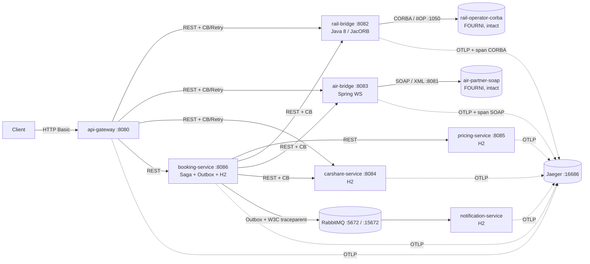

# Plateforme de mobilité multimodale — Fédération SOA, Microservices et CORBA

**Projet IAE — 3ème année GL, ENSIAS Rabat (2026–2027)**
Encadrement : *Pr. Mahmoud NASSAR*

Plateforme unifiée permettant de rechercher et réserver en une seule opération transactionnelle un trajet multimodal combinant **train (CORBA / IIOP)**, **avion (SOAP / WSDL)** et **autopartage (microservice REST)**, sans jamais modifier les deux systèmes partenaires *legacy* fournis.

---

## Architecture



- **Systèmes *legacy* intacts** : `rail-operator-corba/` et `air-partner-soap/` ne contiennent aucune modification par rapport au starter kit.
- **Couche anti-corruption** : `canonical-model` + `rail-bridge` (Java 8 / Spring Boot 2.7 / JacORB 3.9) + `air-bridge` (Java 17 / Spring WS). Les clients ne voient jamais CORBA ni SOAP.
- **Saga orchestrée** (`booking-service`) : phase *hold* sur tous les opérateurs puis phase *confirm*, compensation en ordre inverse sur échec, idempotence par `Idempotency-Key` + hash SHA-256, et *transactional outbox* vers RabbitMQ.
- **Observabilité & résilience** : agent Java OpenTelemetry sur les 7 services + Jaeger + spans manuels CORBA/SOAP + propagation W3C `traceparent` via l'outbox + logs corrélés MDC + circuit breakers/timeouts/retries idempotents Resilience4j.

---

## Démarrage rapide (en une commande)

### Prérequis
- **Docker** et **Docker Compose** (connexion Internet requise au premier build pour Maven Central et l'agent OpenTelemetry).

### Lancement à froid après `git clone`

```bash
docker compose up --build -d
```

Aucune variable d'environnement n'est obligatoire : des identifiants de démonstration par défaut sont configurés dans [`docker-compose.yml`](docker-compose.yml) (surchargeables via `.env`, voir [`.env.example`](.env.example)).

Vérifier que les 11 conteneurs sont démarrés et sains (~45–60 s au démarrage) :

```bash
docker compose ps
```

Pour tout arrêter (conserve les volumes H2/RabbitMQ) :

```bash
docker compose down
```

Pour réinitialiser complètement l'état (volumes compris) :

```bash
docker compose down -v
```

---

## Services, ports et accès

| Service | Rôle | URL hôte | Identifiants par défaut |
|---|---|---|---|
| `api-gateway` | API unifiée REST (`/api/v1/...`) | <http://localhost:8080> | `demo` / `demo-pass` (HTTP Basic) |
| `jaeger` | UI de traçabilité distribuée (OTLP :4318) | <http://localhost:16686> | — |
| `rabbitmq` | Bus d'événements AMQP (:5672) + Management UI | <http://localhost:15672> | `mobility` / `mobility-demo` |
| `rail-bridge` | Bridge CORBA → REST canonique (Java 8) | <http://localhost:8082> | `/actuator/health` |
| `air-bridge` | Bridge SOAP → REST canonique (Java 17) | <http://localhost:8083> | `/actuator/health` |
| `carshare-service` | Microservice autopartage (H2) | <http://localhost:8084> | `/actuator/health` |
| `pricing-service` | Microservice tarification (H2) | <http://localhost:8085> | `/actuator/health` |
| `booking-service` | Orchestrateur Saga + Outbox (H2) | <http://localhost:8086> | `/actuator/health` |
| `notification-service` | Consommateur RabbitMQ dédupliqué (H2) | *(interne)* | logs Docker |
| `rail` *(fourni)* | Opérateur ferroviaire CORBA/IIOP | `localhost:1050` | IOR : `ior/RailBooking.ior` |
| `air` *(fourni)* | Partenaire aérien SOAP/WSDL | <http://localhost:8081/ws/air.wsdl> | — |

> **Date des données de démonstration** : utilisez `2026-11-15` (et un trajet le `2026-11-16`), sinon la recherche renvoie une liste vide. Le vol `AIR:AIR-CMN-MAD-1800` n'a que **3 places** : demander 4 places déclenche volontairement l'échec et la compensation Saga.

---

## Rejouer la démonstration complète

### Script automatisé (recommandé)

- **Windows PowerShell** :
  ```powershell
  powershell -ExecutionPolicy Bypass -File .\docs\requests\demo-p3.ps1
  ```
- **Linux / macOS / Git Bash** :
  ```bash
  ./docs/requests/demo-p3.sh
  ```

Le script exécute et vérifie automatiquement :
1. Santé et état `CLOSED` des circuit breakers ;
2. Recherche multimodale agrégée (`TRAIN` + `CAR`) ;
3. Réservation nominale 3 modes (`TRAIN + AIR + CAR` → `CONFIRMED`), rejeu idempotent et rejet `409` sur conflit de payload ;
4. Réservation en échec (`AIR-CMN-MAD-1800` × 4 places → `CANCELLED`, `TRAIN` + `CAR` `COMPENSATED`, circuit `air-bridge` toujours `CLOSED`) ;
5. Vérification dans l'API Jaeger d'une trace end-to-end contenant les spans `CORBA RailBooking/hold` et `SOAP AirPartner/holdFlight` ;
6. Panne simulée (`docker compose stop rail`), ouverture du circuit breaker, réponses dégradées rapides (`X-Partial-Results: rail`, `X-Degraded-Reason: rail:CIRCUIT_OPEN`), puis redémarrage (`docker compose start rail`) et reprise automatique.

Le déroulé manuel détaillé se trouve dans [`docs/demo-scenario.md`](docs/demo-scenario.md) et la collection REST Client dans [`docs/requests/p3.http`](docs/requests/p3.http).

---

## Lancer les tests automatisés (26 tests)

Sans même nécessiter Maven local (via l'image officielle Maven + JDK 17) :

- **PowerShell** :
  ```powershell
  $repo = (Get-Location).Path
  docker run --rm -v mobility-maven-cache:/root/.m2 -v "${repo}:/workspace" -w /workspace `
    maven:3.9-eclipse-temurin-17 mvn -B -ntp test
  ```
- **Linux / macOS** :
  ```bash
  docker run --rm -v mobility-maven-cache:/root/.m2 -v "$(pwd):/workspace" -w /workspace \
    maven:3.9-eclipse-temurin-17 mvn -B -ntp test
  ```

---

## Documentation et décisions d'architecture (ADR)

| Document | Contenu |
|---|---|
| [`docs/demo-scenario.md`](docs/demo-scenario.md) | Scénario complet de soutenance pas à pas |
| [`docs/bridges.md`](docs/bridges.md) | Contrat REST canonique des bridges P1 |
| [`docs/P2_IMPLEMENTATION.md`](docs/P2_IMPLEMENTATION.md) | Détail des microservices P2, Saga et outbox |
| [`docs/P3_IMPLEMENTATION.md`](docs/P3_IMPLEMENTATION.md) | Journal complet P3 (observabilité, résilience, mesures, tests) |
| [`docs/adr/001-bridges-isoles-et-java8.md`](docs/adr/001-bridges-isoles-et-java8.md) | ADR-001 : Bridges isolés et Java 8 pour JacORB |
| [`docs/adr/002-modele-canonique.md`](docs/adr/002-modele-canonique.md) | ADR-002 : Modèle canonique et couche anti-corruption |
| [`docs/adr/ADR-003-saga-orchestration.md`](docs/adr/ADR-003-saga-orchestration.md) | ADR-003 : Orchestration vs chorégraphie |
| [`docs/adr/ADR-004-saga-idempotence-expiration.md`](docs/adr/ADR-004-saga-idempotence-expiration.md) | ADR-004 : Idempotence, compensation et expiration des holds |
| [`docs/adr/ADR-005-gateway-vs-esb.md`](docs/adr/ADR-005-gateway-vs-esb.md) | ADR-005 : API Gateway vs ESB |
| [`docs/adr/ADR-006-observabilite-resilience.md`](docs/adr/ADR-006-observabilite-resilience.md) | ADR-006 : OpenTelemetry, Jaeger et Resilience4j |
| [`HANDOFF.md`](HANDOFF.md) | Historique de passation P1 → P2 → P3 |
