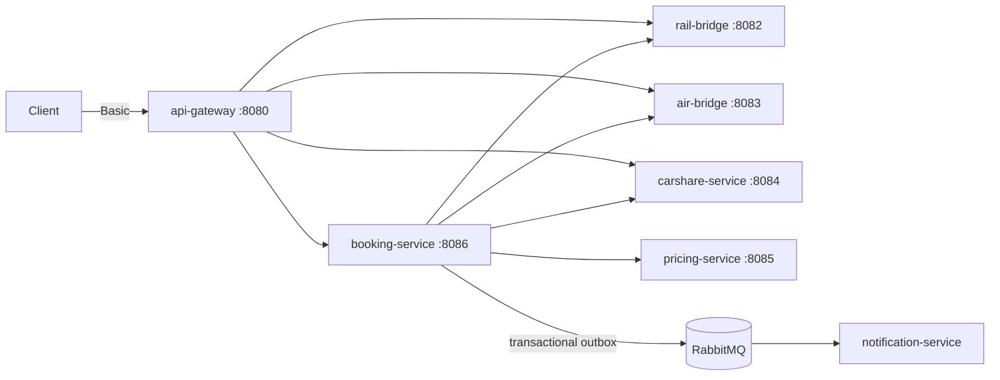

# Implémentation P2 — microservices métier et Saga

## Architecture livrée



Le modèle d'offre des bridges reste celui de `canonical-model` (`Offer`, `TransportMode`, `HoldRequest`, `HoldResponse`, `ConfirmResponse`, `ApiError`). Les services P2 tournent sous Java 17 et les bases H2 sont séparées et persistées par volumes Docker. Les quatre conteneurs P1 et leurs ports ne sont pas modifiés.

## API

### Carshare — `http://localhost:8084`

Reprend à l'identique le contrat bridge : recherche `GET /v1/offers?origin=...&destination=...&date=YYYY-MM-DD`; hold `POST /v1/holds` avec `{"offerId":"CAR:CAR-CAS-RAB-1000","seats":2}`; confirmation `POST /v1/holds/{holdId}/confirm`; annulation idempotente `DELETE /v1/references/{holdId-ou-bookingRef}`. Les offres de démonstration sont Casablanca–Rabat le 15 et le 16 novembre 2026 et Rabat–Tanger le 15. Un hold dure 10 minutes. La ligne d'offre est verrouillée pessimiste pour décrémenter le stock; le statut HELD/CONFIRMED est remplacé une seule fois à l'annulation/expiration. Un balayage périodique et une expiration à la lecture libèrent aussi les holds après redémarrage.

### Pricing — `http://localhost:8085`

`POST /v1/pricing/quote` :

```json
{"segments":[
  {"mode":"TRAIN","priceMinor":8000,"seats":1,"currency":"MAD"},
  {"mode":"AIR","priceMinor":180000,"seats":1,"currency":"MAD"}
]}
```

Réponse : `subtotalMinor`, `feesMinor`, `discountMinor`, `totalMinor`, `currency` et `rule`. En centimes entiers, la règle seedée est **200 centimes par segment** et **5 % de remise sur le sous-total** si les segments comportent plus d'un mode; remise arrondie au centime le plus proche (HALF_UP). La ligne `DEFAULT` est dans la base `pricing_rule`; les frais et points de base peuvent être modifiés dans cette ligne. Les devises non MAD, prix négatifs et quantités non positives sont refusés.

### Booking/Saga — `http://localhost:8086`

`POST /v1/bookings` exige l'en-tête `Idempotency-Key` (1–200 caractères). Exemple de corps :

```json
{"segments":[
  {"mode":"TRAIN","offerId":"RAIL:RAIL-CAS-RAB-0730","origin":"Casablanca","destination":"Rabat","date":"2026-11-15","seats":1},
  {"mode":"AIR","offerId":"AIR:AIR-RBA-ORY-1200","origin":"Rabat","destination":"Paris","date":"2026-11-15","seats":1}
]}
```

Le booking-service relit d'abord chaque offre dans son bridge avec le trajet/date du corps; le prix n'est donc pas pris depuis une valeur fournie arbitrairement par le client. Il demande ensuite le devis au pricing-service. Même clé + même contenu renvoie le même dossier; même clé + contenu différent renvoie 409. `GET /v1/bookings/{bookingId}` retourne le dossier, son devis et les étapes.

La Saga enregistre atomiquement le dossier et toutes les étapes avant les appels. Elle fait tous les holds dans l'ordre, confirme seulement quand chacun est acquis, puis compense en ordre inverse. Après un hold refusé, les holds connus sont annulés. Après un confirm refusé/indécidable, les références confirmées et les holds restants sont annulés. Les DELETE P1 sont idempotents, donc la reprise des compensations est sûre. Les appels hold/confirm ne sont jamais rejoués à l'aveugle. Un timeout de hold sans `holdId` est conservé comme `UNKNOWN_OUTCOME`/`COMPENSATION_PENDING` et réclame une réconciliation opérateur : les bridges P1 ne fournissent pas de recherche par clé de requête qui permettrait de retrouver sûrement ce hold. Un récupérateur traite après cinq minutes les Sagas restées `PENDING`, `HELD` ou `COMPENSATING`; les résultats hold incertains deviennent manuels, les références connues sont compensées. Le corps est limité à dix segments afin que cette fenêtre ne devance pas un appel nominal borné par timeout.

États du dossier : `PENDING`, `HELD`, `CONFIRMED`, `COMPENSATING`, `CANCELLED`, `COMPENSATION_PENDING`. Une étape conserve aussi son état, ses références, son erreur et le nombre d'essais de compensation. Une confirmation démarre immédiatement après les holds; au-delà de neuf minutes, l'orchestrateur choisit de compenser plutôt que de risquer un confirm expiré.

### Gateway — `http://localhost:8080`

- `GET /api/v1/search?origin=...&destination=...&date=...` interroge les trois sources en parallèle, agrège et trie les offres par départ/prix/identifiant. Une panne de source renvoie les résultats disponibles avec `X-Partial-Results: air,car` listant les sources indisponibles.
- `POST /api/v1/bookings` et `GET /api/v1/bookings/{id}` relaient statut et corps du booking-service; `Idempotency-Key` est transmis.
- HTTP Basic requis sur toutes les routes. `GATEWAY_USERNAME` et `GATEWAY_PASSWORD` sont obligatoires et fournis par l'environnement, pas dans le dépôt.

## Événements

Les transitions HELD, CONFIRMED et CANCELLED écrivent les messages `BookingHeld`, `BookingConfirmed`, `BookingCancelled` dans `booking_outbox` dans la même transaction que l'état. Un poller publie les messages persistants vers l'échange topic `booking.events` et ne marque l'outbox publiée qu'après l'acquittement publisher-confirm de RabbitMQ; les erreurs/confirmations ambiguës restent à réessayer. La file durable `booking.notifications` est consommée par notification-service. La livraison est au moins une fois : `eventId` unique dans la base de notification rend les redélivraisons idempotentes. Les messages et statuts apparaissent dans `docker compose logs notification-service`.

RabbitMQ : port AMQP hôte 5672, Management 15672 (`http://localhost:15672`). Les identifiants sont fournis via `RABBITMQ_USERNAME` / `RABBITMQ_PASSWORD`.

## Exécution Windows PowerShell

Depuis la racine du dépôt, avec les services P1 déjà en marche, initialiser des identifiants locaux (ne pas réutiliser un secret réel), construire uniquement les images P2 puis démarrer uniquement les conteneurs P2. `--no-deps` évite de recréer ou redémarrer les bridges P1 :

```powershell
$env:RABBITMQ_USERNAME = "mobility-demo"
$env:RABBITMQ_PASSWORD = [guid]::NewGuid().ToString("N")
$env:GATEWAY_USERNAME = "demo"
$env:GATEWAY_PASSWORD = [guid]::NewGuid().ToString("N")
$env:COMPOSE_PARALLEL_LIMIT = "1"
docker compose build carshare-service pricing-service booking-service notification-service api-gateway
docker compose up -d --no-deps rabbitmq carshare-service pricing-service booking-service notification-service api-gateway
docker compose ps
docker compose logs booking-service notification-service
```

Conserver ces mêmes identifiants pour les redémarrages tant que les volumes persistent : RabbitMQ ne remplace pas automatiquement son utilisateur lorsque `RABBITMQ_PASSWORD` change.

Les images Maven/Eclipse Temurin 17 construisent chaque service séparément depuis la racine, dépendance canonique incluse. Test ciblé complet des modules P2 :

```powershell
$repo = (Get-Location).Path
docker run --rm -v mobility-p2-maven-cache:/root/.m2 -v "${repo}:/workspace" -w /workspace maven:3.9-eclipse-temurin-17 `
  mvn -B -ntp -pl carshare-service,pricing-service,booking-service,notification-service,api-gateway -am test
```

Démo API exécutable : `docs/requests/verify-p2.ps1`. Requêtes IntelliJ/VS Code : `docs/requests/p2.http`. Scénarios de régression P1 : `docs/requests/bridges.http`.

Les volumes sont nommés `carshare-data`, `pricing-data`, `booking-data`, `notification-data` et `rabbitmq-data`. Un arrêt ordinaire conserve les données; ne pas employer `docker compose down -v` pour une démonstration dont les données doivent être conservées.

## Limites / intégration ultérieure

- Les bases H2 conviennent au kit local et à la démonstration; pas à un déploiement HA.
- L'authentification Basic de démonstration est destinée au réseau local/TLS de confiance, pas à une exposition Internet.
- Le prix est résolu via les offres des bridges au moment de la réservation.
- Si le hold distant réussit mais que son identifiant est perdu dans un timeout, la Saga ne peut pas deviner une référence. Elle persiste l'incertitude et demande une réconciliation. Pour une garantie plus forte, P3 peut introduire des clés d'opération idempotentes propagées jusqu'aux fournisseurs.
- Traces distribuées, Jaeger et circuit breaker Resilience4j ne sont pas inclus; les points d'intégration sont les appels REST de booking-service et l'outbox RabbitMQ.
