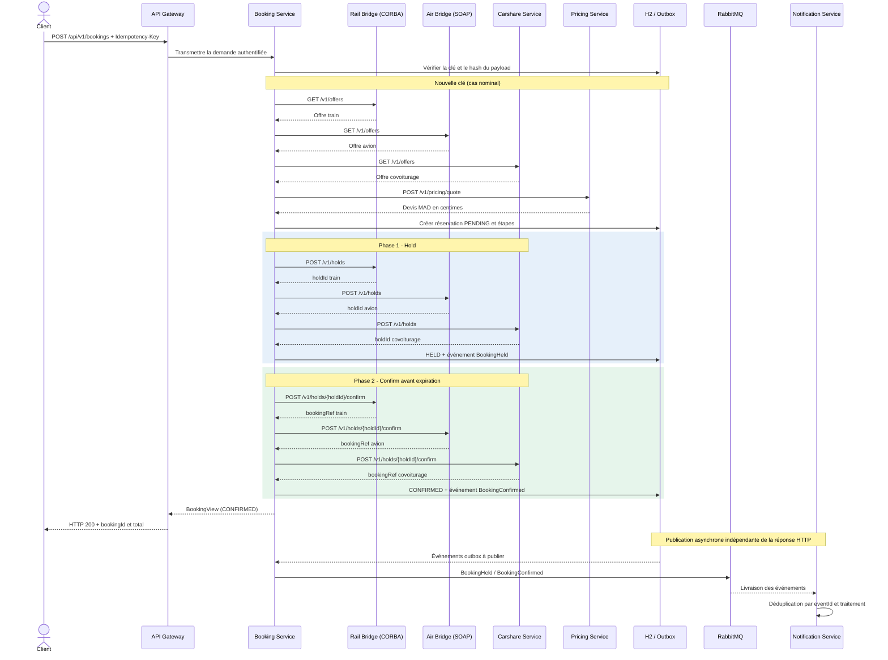
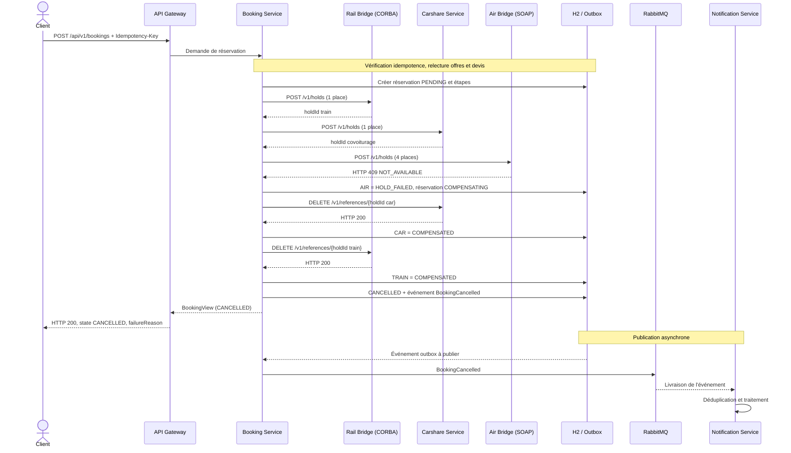
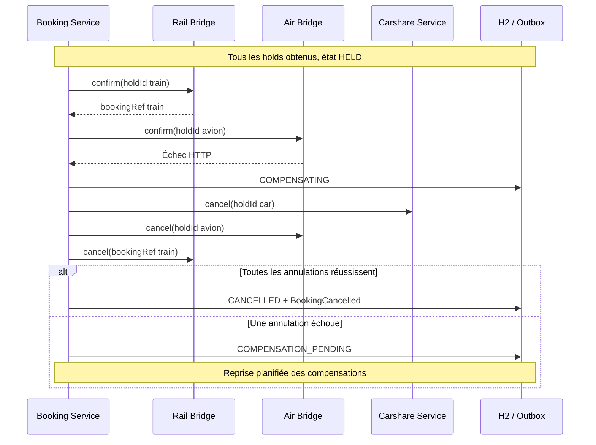

# Diagrammes de séquence — Saga de réservation multimodale

La Saga est orchestrée par `booking-service`. Les fournisseurs sont accessibles via une API REST canonique : `rail-bridge` (CORBA), `air-bridge` (SOAP) et `carshare-service` (REST natif). Les diagrammes suivent les scénarios de `demo-scenario.md` et l'implémentation de `BookingService.java`.

## 1. Cas nominal — réservation confirmée

## 2. Cas d'échec — compensation des holds

Scénario de démonstration : TRAIN puis CAR, puis AIR avec 4 places demandées pour une offre de 3 places. Les compensations s'effectuent dans l'ordre inverse.

## 3. Variante — échec pendant la confirmation

## Règles de cohérence

- Les holds expirent après 10 minutes ; l'orchestrateur vérifie une marge de 9 minutes avant la confirmation.
- Une même clé d'idempotence et un payload identique retournent la réservation existante ; un payload différent provoque HTTP 409.
- Les annulations sont idempotentes. Les holds et confirmations ne sont pas rejoués automatiquement ; les lectures et annulations peuvent bénéficier du retry de Resilience4j.
- Un timeout de hold sans référence connue entraîne `UNKNOWN_OUTCOME` et peut nécessiter une réconciliation manuelle ; la réservation reste `COMPENSATION_PENDING`.
- L'outbox assure la publication asynchrone des événements ; la notification déduplique par `eventId`. La cohérence globale est à terme, et non une transaction ACID distribuée.

## Références internes

- [Sémantique Saga](03-semantique-saga.md)
- [Scénario de démonstration](demo-scenario.md)
- [Implémentation P2](P2_IMPLEMENTATION.md)
- `booking-service/src/main/java/ma/mobility/booking/service/BookingService.java`
- `booking-service/src/main/java/ma/mobility/booking/service/BookingPersistence.java`
